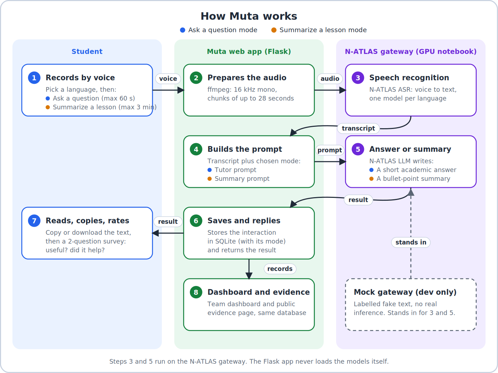

<div align="normal">


# Muta

**A voice-first academic assistant for Nigerian students.**

<br/>

[](#)
[](https://muta-rpnz.onrender.com)


## Table of Contents

- [Overview](#overview)
- [Features](#features)
- [How it works](#how-it-works)
- [Getting Started](#getting-started)
- [Project Map](#project-map)
- [API Endpoints](#api-endpoints)
- [Privacy and Security](#privacy-and-security)
- [Testing and Evaluation](#testing-and-evaluation)
- [Environment Variables](#environment-variables)
- [Known Limitations](#known-limitations)
- [Documentation](#documentation)

---

## Overview

**A voice-first academic assistant for Nigerian students.**

Muta lets students ask academic questions and request lesson summaries by voice. It supports manually selected Nigerian English, Hausa, Yoruba, and Igbo, and uses the N-ATLAS gateway for speech recognition and AI responses.

**Live demo:** <https://muta-rpnz.onrender.com> (hosted on a free plan, so the first load after idle can take about a minute; real answers need the N-ATLAS notebook to be running)


## Features

- Voice-based academic questions and lesson summaries.
- Manual language selection for Nigerian English, Hausa, Yoruba, and Igbo.
- Speech recognition and academic responses through N-ATLAS.
- Audio conversion and chunking for processing longer recordings.
- Anonymous interaction logging and user feedback.
- Dashboard, CSV export, and evidence reporting.
- Optional WhatsApp integration, disabled by default.
- Local mock gateway for development without a GPU.

## How it works



<details>
<summary><b>Text version of the diagram</b></summary>

```
 Modes:  [Ask a question]  record up to 60 s -> a short academic answer
         [Summarize a lesson]  record up to 3 min -> a bullet-point summary

 1  Student picks a language and a mode, then records by voice (phone or laptop browser)
 2  Muta web app (Flask) prepares the audio ... ffmpeg: 16 kHz mono, chunks of up to 28 seconds
 3  N-ATLAS ASR ............................... voice -> transcript            [N-ATLAS gateway]
 4  Muta web app builds the prompt ............ Ask: tutor prompt | Summarize: summary prompt
 5  N-ATLAS LLM ............................... academic answer or summary     [N-ATLAS gateway]
 6  Muta web app saves and replies ............ interaction (with its mode) stored in SQLite
 7  Student reads, copies or downloads the text, then answers the 2-question survey
 8  Team dashboard + public evidence page ..... both read the same database

 Development only: scripts/mock_gateway.py can stand in for steps 3 and 5
 (labelled fake text, no real inference).
```

</details>

The Flask app and N-ATLAS models run as separate services. The mock gateway is only for testing the application flow; it does not run real N-ATLAS inference.

## Getting Started

### Prerequisites

Install the following:

- Python version supported by the project's dependencies. Python 3.12 is recommended if it matches the repository's requirements.
- Git.
- FFmpeg, if required by the audio-processing setup.
- A code editor such as Visual Studio Code.

### 1. Clone the Repository

Open PowerShell, CMD, or your terminal and run:

```bash
git clone https://github.com/fachiny17/muta.git
cd muta
```

If Git is not installed, download Git for Windows from:

https://git-scm.com/download/win

After installing Git, restart your terminal and verify the installation:

```bash
git --version
```

### 2. Create a Virtual Environment

**Windows (PowerShell):**

```powershell
py -3.12 -m venv venv
.\venv\Scripts\Activate.ps1
```

**Windows (CMD):**

```bat
py -3.12 -m venv venv
venv\Scripts\activate
```

**macOS/Linux:**

```bash
python3 -m venv venv
source venv/bin/activate
```

If Python 3.12 is unavailable, check the project's dependency requirements before choosing another version.

### 3. Install Dependencies

Upgrade pip:

```bash
python -m pip install --upgrade pip
```

Install the development dependencies:

```bash
pip install -r requirements-dev.txt
```

If the development requirements file is unavailable, check the repository for the appropriate requirements file.

### 4. Configure Environment Variables

Check for an `.env.example` file in the project root.

Copy it to `.env`:

**Windows (PowerShell):**

```powershell
Copy-Item .env.example .env
```

**Windows (CMD):**

```bat
copy .env.example .env
```

**macOS/Linux:**

```bash
cp .env.example .env
```

Open `.env` in your editor and configure the required settings. The original setup instructions identify these variables:

- `SECRET_KEY`
- `DASHBOARD_KEY`
- `GATEWAY_URL`
- `GATEWAY_KEY`

For local mock development, configure the gateway URL and authentication key according to the mock gateway's implementation and the project's setup guide.

Use `.env.example`, the application configuration, and the documentation to determine the complete set of required variables.

Never commit `.env` or publish real credentials and API keys.

### 5. Run Automated Tests

From the project root, run:

```bash
python -m pytest -q
```

The tests help verify application functionality. Their coverage depends on the tests included in the repository.

## Running Locally Without a GPU

The mock gateway allows you to test the web application without downloading or loading the real N-ATLAS models.

**Important:** Mock mode does not demonstrate the actual speech recognition or AI response quality of the real N-ATLAS models.

### Terminal 1: Start the Mock Gateway

Activate the virtual environment, then run:

```bash
python -m scripts.mock_gateway
```

Keep this terminal running.

### Terminal 2: Start the Flask Application

Open a second terminal in the project directory, activate the virtual environment, and run:

```bash
python run.py
```

### Open the Application

Visit the local address shown in the terminal, typically:

http://localhost:5000

### Terminal 3: Run the Smoke Test

With the application and mock gateway running, execute:

```bash
python -m scripts.smoke_test http://localhost:5000
```

This checks the running application according to the smoke-test script's implementation.

If a command fails, review the error message and verify that the referenced file and required configuration exist.

## Run with real N-ATLAS

Real speech recognition and language model inference require a reachable GPU-hosted gateway with the required models and dependencies.

1. Open the project's N-ATLAS notebook (Google Colab, GPU runtime) and run its cells in order until the gateway is started. Add these Colab Secrets with notebook access ON: `HF_TOKEN`, `GATEWAY_KEY`, and, to let the hosted app find the gateway automatically, `APP_URL` and `ADMIN_KEY`. Details: [`docs/REAL_NATLAS_COLAB.md`](docs/REAL_NATLAS_COLAB.md).
2. Keep the notebook runtime active while using Muta. **If the notebook stops or disconnects, N-ATLAS goes offline and real inference will not work.**
3. For local runs, set `GATEWAY_URL` in `.env` to the active gateway URL and `GATEWAY_KEY` to the matching gateway key. (On the hosted app the notebook re-registers its URL every minute, so nothing needs editing there.)
4. Start or restart the web app with `python run.py`.
5. To check the gateway, run `python -m scripts.test_gateway` from the project environment.

The Flask app does not start the AI models itself. The notebook and the web app must both be running for real model-powered requests to work.

## Project Map

| Path | Purpose |
|---|---|
| `run.py` | Starts the Flask application. |
| `app/routes.py` | Web pages, APIs, dashboard, and exports. |
| `app/pipeline.py` | Coordinates audio transcription, response generation, and feedback. |
| `app/natlas_client.py` | Communicates with the N-ATLAS gateway. |
| `app/audio.py` | Prepares and chunks audio. |
| `app/db.py` | SQLite records and metrics. |
| `gateway/gateway.py` | N-ATLAS model gateway service. |
| `scripts/` and `tests/` | Development tools and automated tests. |
| `templates/` and `static/` | Web interface and frontend assets. |
| `notebook/` | Notebook-based experimentation, when included. |
| `docs/` | Setup, architecture, and deployment guides. |


## API Endpoints

| Endpoint | Access | Purpose |
|---|---|---|
| `POST /api/ask` | Public | Submit an audio question or lesson-summary request. |
| `POST /api/feedback` | Public (own interactions only) | Submit the survey answers. |
| `GET /health`, `GET /healthz` | Public | Gateway status and a cheap liveness check. |
| `/evidence` | Public | Frozen pilot results (appears after you publish a snapshot). |
| `/login`, `/logout` | Team | Team password login. |
| `/dashboard`, `/export.csv` | Team login | Live statistics and metrics export. |
| `/admin/backup.sqlite`, `/internal/gateway` | Admin key or team login | Database backup; gateway URL registration. |

## Privacy and Security

- Anonymous IDs use the `USR_XXXXXXXX` format.
- The documented interaction flow does not collect names, email addresses, or phone numbers.
- Audio recordings are intended to be deleted after processing.
- The metrics CSV does not include question text.
- Exporting question text requires the admin key, according to the original project documentation.
- Production secrets should be configured through environment variables.
- Never commit `.env`, private credentials, or sensitive datasets.

Review the current implementation and deployment settings before using real student data.

## Testing and Evaluation

Run the automated test suite:

```bash
python -m pytest -q
```

Run the smoke test against a running local application:

```bash
python -m scripts.smoke_test http://localhost:5000
```

The repository also includes evaluation and reporting utilities, such as `scripts/evaluate_asr`, `scripts/make_report`, and `scripts/publish_evidence`.

Consult the relevant scripts and documentation for their arguments and requirements. Speech recognition quality should be evaluated separately across supported languages.

## Known Limitations

- Language selection is manual; automatic language detection is not currently available.
- Speech recognition quality may vary across languages and accents.
- Audio interaction uses push-to-talk recording rather than continuous live streaming.
- Real inference depends on the availability of the GPU-hosted N-ATLAS gateway.
- Free hosting services may sleep or have ephemeral storage.
- Data stored on an ephemeral filesystem may not survive restarts or redeployments.
- Mock responses do not represent real N-ATLAS inference quality.

## Documentation

- [`docs/WEB_GUIDE.md`](docs/WEB_GUIDE.md) — application walkthrough.
- [`docs/ARCHITECTURE.md`](docs/ARCHITECTURE.md) — system design.
- [`docs/REAL_NATLAS_COLAB.md`](docs/REAL_NATLAS_COLAB.md) — running the real N-ATLAS gateway on Colab.
- [`docs/FREE_HOSTING.md`](docs/FREE_HOSTING.md) — free hosting plan (Render Free).
- [`docs/DEPLOY_RENDER.md`](docs/DEPLOY_RENDER.md) — paid Render option (persistent disk).